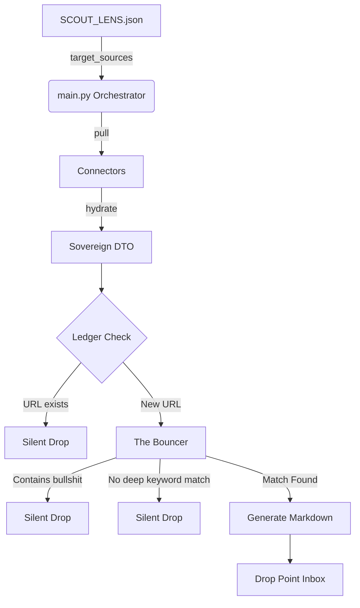

# Harvester Architecture

Harvester is built on strict engineering principles inspired by the dammgo labs V5 Architecture. It acts as an unbreakable deterministic firewall before data reaches the cognitive layer (LLMs).

## 🛡️ Core Pillars

1. **Sovereign DTOs (The Anti-Corruption Wall)**
   - Located in `core/dtos.py`.
   - The Core Domain (Bouncer, Ledger) never interacts with raw external payloads (e.g., `requests` responses or `feedparser` dictionaries). Connectors must map external data to immutable `HarvesterPayloadDTO` dataclasses before passing it inward.
2. **SRP & DDD Isolation**
   - **Infrastructure**: `connectors/` (external pull), `core/ledger.py` (SQLite persistence).
   - **Domain**: `core/bouncer.py` (business rules for string matching), `core/dtos.py`.
   - **Application**: `main.py` (orchestrates the flow).
3. **Implicit OR (Bilingual Scanning)**
   - The `deep_keywords` array inside `SCOUT_LENS.json` is evaluated as a massive boolean `OR` block. This allows researchers to append translations (e.g., English and Spanish versions) of the same logical condition without writing complex string parsers.

## ⚙️ The Components

1. **Lens Parser (`core/lens_parser.py`)**: Loads the `SCOUT_LENS.json` contract to determine the mission parameters and the target URLs (`target_sources`).
2. **Connectors (`connectors/`)**: Pluggable modules (e.g., RSS, Reddit) that pull data and hydrate Sovereign DTOs.
3. **The Bouncer (`core/bouncer.py`)**: The deterministic filter. It purges any text containing strings from the `bullshit_filter` and ensures relevance using `deep_keywords`.
4. **Ledger (`core/ledger.py`)**: A SQLite micro-database that ensures no URL is processed twice, saving massive CPU and network resources.

## 🔒 OpSec & Credentials
All external connectors requiring authentication (Reddit, APIs) rely on a `.env` file. These files are strictly ignored by version control. See `.env.template` for the required keys.

## 🔄 Data Flow

---
**dammgo labs** - _Engineering Longevity. Signal over noise._
